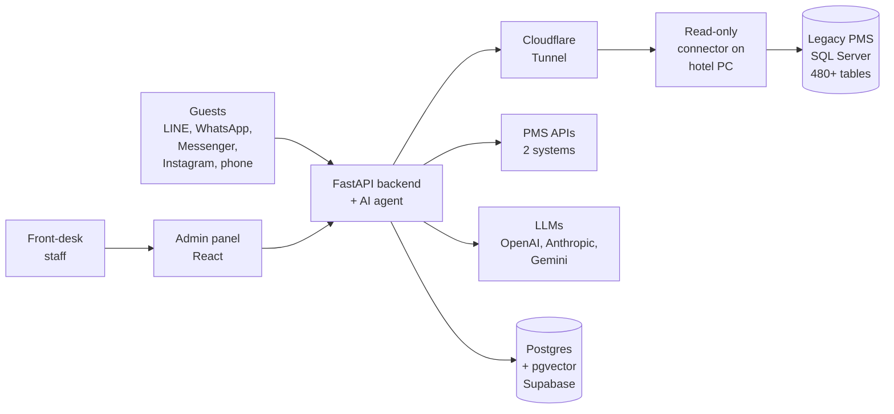

# Jay Lai

I build AI software that hotels use to run their front desks.

Since 2024 I've been the founder and lead engineer of [Salty Cloud AI](https://saltycloud.ai). Our platform answers guests for ~70 hotels in Taiwan: around 11,000 messages a day, with ~60% handled without a person stepping in. I'm also an undergrad at the University of Washington in Seattle (intended CS major).

Most of my code lives in private repos because it touches guest IDs, payments and client data. This page is the next best thing: what I built, how it works, and what broke along the way. Happy to walk through the code on a call.

---

## Salty Cloud

A hotel connects its LINE, WhatsApp, Messenger and Instagram accounts, and an AI agent starts answering guests from that hotel's own knowledge base and live booking data. Some hotels also put voice AI on their phone line. Anything the agent can't handle goes to front-desk staff in the admin panel.

What's in it:

- **Guest messaging.** RAG over each hotel's FAQs (pgvector), plus Gemini to read the photos guests send.
- **Mobile check-in.** Before arrival, the guest scans their ID (Gemini OCR), passes a face match with a liveness check, pays, and gets an e-invoice. At the hotel they pick up a room card from a QR kiosk. ID photos are deleted from S3 automatically after 30 days.
- **PMS integrations.** Two of Taiwan's major property management systems, connected over their APIs. With live booking data, the agent can answer "is my booking confirmed?" and send door codes on its own.
- **A connector for PMSs with no API.** This was the hard part. Details below.

At 60% of our client hotels, front-desk staffing dropped by at least half, in some cases from two people per shift to none. One hotel group now runs 4 hotels from a single remote front desk.

<b>How the legacy PMS connector works</b>

 

About half our hotels run an older PMS on a PC in the back office. There's no API, just a SQL Server database with 480+ tables.

- **Read-only FastAPI service on the hotel's PC.** It exposes a fixed set of read-only views, not raw tables.
- **Encrypted Cloudflare Tunnel.** The connection goes outbound, so the hotel never opens a port on its router.
- **Runs unattended.** A watchdog restarts it if it hangs, and I can push updates remotely and roll back if one goes wrong. Nobody wants to drive to a hotel to reinstall something.
- **Gentle on the hotel's server.** Room availability is cached in Postgres, so the hotel's PC gets asked at most once every 10 minutes, and not at all if no guest asks.
- **Answers hotels are comfortable with.** The agent says "available", "only a few left" or "sold out", never the exact count. Hotels don't want guests to see that only one room is left.

## Built for specific clients

Same platform underneath, reshaped for one customer at a time.

**Mini Ken: decision support for a 24-hotel group.** I built this one solo. It pulls data from 8 of the group's systems and routes each question across multiple LLMs, failing over when a provider is down. 80 managers and staff use it daily, for anything from pricing to guest disputes.

**Cloudlift: deploys for people who don't code.** For the same group. A self-hosted deployment platform (AWS Lightsail, Coolify, FastAPI) packaged as a Claude Code / Codex skill. I trained 24 managers with no coding background, and they now run 18 apps they built with AI.

**A poker club with 5,700+ members.** I spent 3 weeks on site with their 30+ staff, then replaced 3 separate systems (tournaments and prizes, POS, loyalty points) with one platform: member CRM, eKYC sign-up, tournament management, and AI invitations timed to each player's history and usual hours. It contributed to a 30% revenue increase after launch.

**A real-estate sales team.** Ad conversion tracking, SEO, AI chat and phone support, and a CRM that routes each lead to a sales rep with an AI-written brief. About 200 leads in 2 months, supporting 10 unit sales (~US$11M).

## Public project: [AI Trader](https://github.com/tiramisuice/ai-trader)

10 LLM agents (Claude and GPT) paper-trade U.S. and Taiwan stocks against buy-and-hold. Each one has a persona, a private journal it remembers across runs, live web research, and my quant engine (technical signals, five-factor model, HMM regime detection). FastAPI + Next.js, with a [live dashboard](https://ai-trader-web.fly.dev).

What came out of it so far:

- In season 2, agents decided when to wake up and trade instead of running on a timer. Trades fell ~99%, from 13,224 to 113.
- Costs flipped the scoreboard. One agent showed +40% on paper and a ~9% loss after commissions and taxes.

## Things that broke, and what I changed

- **Deploys were killing background work.** A hotel's data import spun for 30 minutes because three deploys in a row killed it. Long jobs now go through a job queue on a separate worker machine.
- **The model sometimes returns nothing.** An empty LLM reply meant the guest got silence: no answer, no handoff to staff. Now any turn that would send nothing is treated as a failure.
- **Dates without a year are a trap.** In testing, the agent read a guest's "12/31" in October as last December. Dates more than 60 days in the past now roll forward a year.
- **Staging isn't a sandbox.** Production and staging share one database, so every schema change has to keep the code already in production working.
- **A merged PR doesn't mean every commit made it.** A commit pushed 13 minutes after the merge never reached main, and nobody noticed for two weeks. I now check with `git merge-base --is-ancestor`, not the PR status.

## Stack

**Languages:** Python, TypeScript, SQL, Java, C++ 
**Backend & data:** FastAPI, Postgres (Supabase, Neon), SQL Server, pgvector 
**Frontend:** React, Next.js 
**AI:** OpenAI, Anthropic and Gemini APIs, RAG, multi-model routing 
**Infra:** Fly.io, Vercel, Cloudflare (Workers, Pages, R2, Tunnel), AWS (EC2, S3, Lightsail), Coolify

I build with Claude Code and Codex: custom skills, parallel agents in separate git worktrees, and a verification workflow where fresh agents test a change against written acceptance criteria.

## Contact

jaylai@uw.edu · [LinkedIn](https://linkedin.com/in/jay-lai-uw) · [saltycloud.ai](https://saltycloud.ai) · English / 中文
